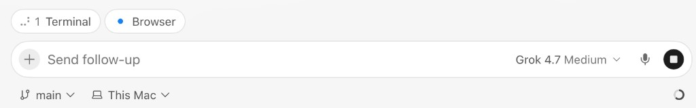

# The Canon

The Canon is a four-year bucket list that a campus writes for itself. Students of Yale's fourteen residential colleges propose tasks, vote the best of them to the top of the book, and finish the ones that make it in. A finish is meant to be hard to fake: the phone has to be at the place, during the hours that task is open, with a live photo and a second person who is there too.

The book is one page with five sections: Standings, Profile, Vote, Propose, and Finish.

## Demo Video

https://github.com/user-attachments/assets/f58fe3f0-1991-4de1-8f24-29fed4203507

## What a week does

Anyone in the book can put up to five proposals on the ballot each week. A proposal has a title, a sentence for what counts, a section, a difficulty, a campus place, the hours it can be finished, and who confirms it. The campus place is typed. If the words match a known place, such as Silliman or Sterling Memorial Library, the proposal keeps that pin. Any other place is kept as written.

Each student gets one vote on each task, except their own proposal. The five tasks with the most votes are the top of the book. Votes clear every Monday at midnight, campus time. A proposal that is still in the top five when the votes clear joins the book for good. The rest of the ballot starts over, and each student gets five new proposals for the new week.

A counted finish adds that task's points to the student's residential college:

| Difficulty | Points |
| --- | --- |
| Modest | 2 |
| Marked | 3 |
| Severe | 5 |
| Rare | 8 |

Standings rank the fourteen colleges by those points. The leader is named at the top, each college has a bar against the leader, and the signed-in student's college is marked.

## How a finish counts

Finishing is separate from voting. When the real check is on, the phone has to be inside the place, during that item's window.

- Sunrise at East Rock opens for twenty minutes on either side of sunrise.
- The Game opens only while that game is being played, once at the Bowl and once at Harvard.
- The dining-hall day opens during meal hours and needs every college hall on the same campus day.
- The snow item opens only when it is actually snowing on campus.
- A sealed item stays off the public ranking until someone finishes it. The title stays visible, so a first person can still do it.

On the Finish page today, a student names the person they were with and the task is entered. That path is only for the demonstration. It skips the camera, the map, and the second phone. Completed tasks sit in a green section and drop out of the open list. A confirmation, such as "It's on the ballot," shows on the page where the action happened, fades after a few seconds, and does not follow you elsewhere.

## Verification, when it is turned on

The demonstration box is a stand-in. The check below is what Finish will run instead. The rules for it are already in `rules.js`. The screen does not call them yet.

A finish has to pass in order. If one step fails, nothing is written down.

The task has to be in the book, not still on the ballot, and open at that minute. The gates are the ones above: sunrise, snow, meal hours, The Game, the last semester. A closed window is a no.

The phone reads its location once. The server compares that point with the fence for the task and keeps the answer, yes or no. The coordinates are thrown away. A yes from the wrong fence fails the same way a no does. The dining-hall day is the odd case: each hall is its own fence, and all fourteen have to be done on the same campus day. The Game is two fences, the Bowl and Harvard, and each one is open only while that game is being played.

Then the page opens the camera. The picture has to be taken on that screen. There is no file picker, and a picture already on the phone does not count.

The first phone shows a six-digit code for one minute. A second student, standing in the same fence, types the code and takes their own picture. The same two people can do this three times. After that the pair is used up, and a later finish needs someone else. The point is that one loyal friend cannot carry a whole year.

A hosted task, a tea or a rehearsal or a meal with a professor, skips the friend. The host named for that item has to be at the place too, and has to mark the student present. Until a real NetID is written in `data/hosts.json` for that item, nobody can stamp it.

What remains is a proof: the two photos, the place name, and the time. It sits for a day where other colleges can see it. One college can flag it. That flag does nothing by itself. A second college, a different one, strikes the finish. The student and the witness, or the host, each lose one challenge. Everyone starts with three. At zero, a later finish does not count. If the day ends with fewer than two colleges against it, the points go to the student's college.

## Who can enter

Sign-in for a real session is Yale's own NetID page, [Central Authentication Service](https://secure.its.yale.edu/cas/login). The password is entered there and never sent to this book. After Yale redirects back, the server checks the ticket with Yale and refuses the session unless the reply names the person as a student. Faculty, staff, and affiliate NetIDs stay out. Yale only releases that student fact, and only accepts the callback, after Identity and Access Management registers the service URL.

For a demonstration, a visitor can enter with a name and no NetID. After choosing a residential college, that person can propose, vote, and finish. Signing in later with the same name returns to the same place in the book.

The fourteen residential colleges, as published by [Yale Housing](https://housing.yale.edu/undergraduate-housing/residential-colleges), are Benjamin Franklin, Berkeley, Branford, Davenport, Ezra Stiles, Grace Hopper, Jonathan Edwards, Morse, Pauli Murray, Pierson, Saybrook, Silliman, Timothy Dwight, and Trumbull. A student chooses theirs once. It cannot be switched from the page.

A head of college or professor who should mark hosted items is named in `data/hosts.json`, by item id and NetID. Until a NetID is named, no one can stamp that hosted item.

Profile shows how many tasks in the book are finished, the proofs that have counted, the ones still waiting out the challenge day, and the ones that were struck.

## The sample book

- Eat in every dining hall in one day.
- Stay for a full lecture in a department you will never major in.
- Watch the sun come up from East Rock.
- Go to a master's tea in a college that is not yours.
- Be in the stands for The Game at home and away.
- Leave a note in a library book.
- Walk out of Sterling into the first snow.
- Have a meal with a professor you do not have class with.
- Show up for one rehearsal in an art you do not practice.
- In your last semester, do the thing seniors in your college say they regret skipping.

Fences are approximate campus points, tight enough that a check-in from across town fails.

## Built with Grok

This app was written in Cursor with Grok. The screenshot below is the composer during that work, with Grok 4.7 Medium selected.

## This repo

| Path | What it is |
| --- | --- |
| `index.html` | The book |
| `styles.css` | The page |
| `app.js` | The camera, the place check, and the screen |
| `canon.js` | Places, people, and the starting items |
| `rules.js` | Votes, windows, pairs, challenges, standing |
| `rules.test.js` | The rules, without a browser |
| `server.js` | Yale sign-in, the demonstration entry, the session, and the book |
| `grok-in-cursor.jpg` | The composer, showing Grok was used to build this |
| `Real.mp4` | A recording of the book |

From this folder, run `node server.js` and open `http://127.0.0.1:8765`. Register that exact callback, `http://127.0.0.1:8765/auth/callback`, with Yale if you are signing in from this machine. The rules alone can be checked with `node rules.test.js`.
